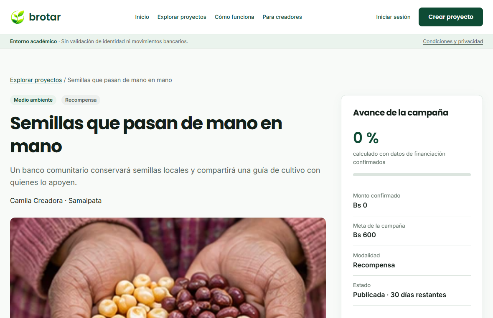
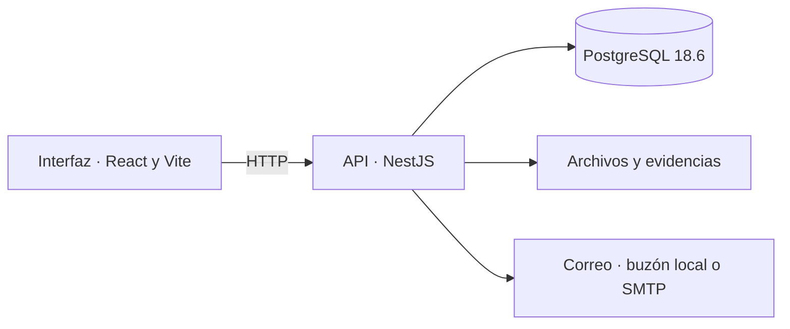

# Brotar

Plataforma de financiamiento colectivo para iniciativas comunitarias. Un creador presenta su proyecto, los patrocinadores eligen cómo apoyarlo y, al finalizar, pueden consultar los avances y la rendición de los fondos.

**[Instalar y probar](#instalar-y-probar)** · **[Manual de usuario](docs/entregables/defensa-final/Manual_de_usuario_Brotar.pdf)** · **[Manual técnico](docs/Manual_Tecnico.pdf)**



*Semillas que pasan de mano en mano*, una de las 20 campañas incluidas en la instalación de revisión. Esta versión utiliza datos de práctica, pagos simulados y condiciones provisionales.

## Instalar y probar

Elegí el recorrido según el entorno del equipo.

| Modalidad | Qué vas a obtener |
| --- | --- |
| **Práctica guiada** (pasos de abajo) | PostgreSQL en Docker, cliente y API en el equipo, con cuentas y campañas preparadas. |
| [Tres servicios en Docker](docs/docker-v3.md) | Frontend, API y PostgreSQL en contenedores con datos de evaluación y comprobaciones de salud. |
| [Instalación nativa](docs/instalacion-nativa-v3.md) | PostgreSQL local con esquema, migraciones, categorías y registro de la primera cuenta. |

Necesitás **Git**, **Node.js 24** (desde 24.13.0), **Bun 1.4.2**, **pnpm 11.19.0** mediante Corepack y **Docker Desktop** con el motor Linux en ejecución. Docker aloja PostgreSQL. La interfaz y la API se ejecutan en tu equipo.

**1. Prepará una copia con datos de ejemplo.** Desde PowerShell, en una carpeta nueva:

```powershell
git clone --branch main https://github.com/luisrocha159/CrowFunding-Brotar.git Brotar
cd Brotar
node scripts/setup-review.mjs
```

El preparador instala dependencias, aplica las migraciones y carga las categorías, 18 cuentas y 20 campañas. Si ya usás los puertos 5173, 3000 o 15460, elegí los puertos alternativos antes de la primera instalación. [Instalación y puertos en el manual técnico](docs/Manual_Tecnico.pdf)

**2. Iniciá ambos servicios.** Abrí dos terminales en la carpeta `Brotar` y dejalas abiertas.

| Terminal | Comando |
| --- | --- |
| API | `node scripts/start-review.mjs backend` |
| Interfaz | `node scripts/start-review.mjs frontend` |

**3. Abrí [Brotar en tu equipo](http://127.0.0.1:5173)** y elegí **Explorar proyectos**. Podés consultar las campañas como visitante. Para ensayar un aporte, iniciá sesión con la cuenta local `patrocinador@brotar.test` y la contraseña de práctica `patrocinador1234567890`.

<details>
<summary>Cómo comprobar la instalación, volver otro día o revisar el correo</summary>

- **Comprobar el arranque.** Con los dos servicios activos, abrí la [sonda de preparación de la API](http://127.0.0.1:3000/api/health/ready). Antes de usar los escenarios, podés comprobar los datos iniciales ejecutando `node scripts/verify-review.mjs` desde la carpeta `backend`.
- **Volver otro día.** Iniciá Docker, ejecutá de nuevo `node scripts/setup-review.mjs` en esta copia para levantar su base y arrancá los servicios del paso 2. Repetir el preparador conserva los avances.
- **Ver un correo de práctica.** Desde la raíz, ejecutá `node scripts/review-mailbox.mjs correopendiente@brotar.test`. Esta instalación usa un buzón local. Para configurar Gmail en una instalación ordinaria, consultá el apartado 7.1 del [manual técnico](docs/Manual_Tecnico.pdf).

</details>

## Cómo está construido



El frontend está en `src/`, los módulos del servidor en `backend/src/` y la instalación de PostgreSQL en `infra/postgres-v2/`. El manual técnico describe la arquitectura, las migraciones, el diccionario de datos y la recuperación de respaldos. [Manual técnico](docs/Manual_Tecnico.pdf)

## Documentos de la entrega

| Manual | Qué podés consultar |
| --- | --- |
| [Manual de usuario (PDF)](docs/entregables/defensa-final/Manual_de_usuario_Brotar.pdf) | Cómo crear una campaña, realizar un aporte, consultar su estado y pedir ayuda. |
| [Manual técnico (PDF)](docs/Manual_Tecnico.pdf) | Cómo instalar y configurar Brotar, administrar la base de datos y recuperar un respaldo. |
