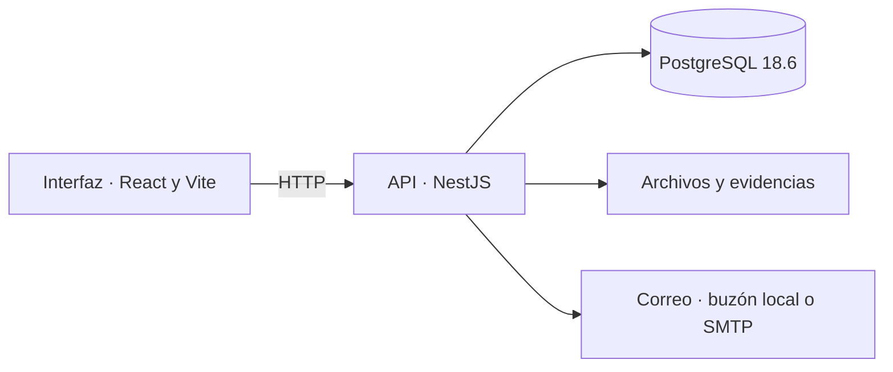

# Brotar

Plataforma de financiamiento colectivo para iniciativas comunitarias. Un creador presenta su proyecto, los patrocinadores eligen cómo apoyarlo y, al finalizar, pueden consultar los avances y la rendición de los fondos.

**[Instalar y probar](#instalar-y-probar)** · **[Ver la demostración](docs/entregables/defensa-final/Demostracion_en_vivo.pdf)** · **[Leer el manual de usuario](docs/entregables/defensa-final/Manual_de_usuario_Brotar.pdf)**


*Semillas que pasan de mano en mano*, una de las 20 campañas incluidas en la instalación de revisión. La entrega académica utiliza datos de práctica, pagos simulados y condiciones provisionales.

## Instalar y probar

Necesitás **Git**, **Node.js 24** (desde 24.13.0), **Bun 1.4.2**, **pnpm 11.19.0** mediante Corepack y **Docker Desktop** con el motor Linux en ejecución. Docker aloja PostgreSQL. La interfaz y la API se ejecutan en tu equipo.

**1. Prepará una copia con los casos de la defensa.** Desde PowerShell, en una carpeta nueva:

```powershell
git clone --branch main https://github.com/luisrocha159/CrowFunding-Brotar.git Brotar
cd Brotar
node scripts/setup-review.mjs
```

El preparador instala dependencias, aplica las migraciones y carga las categorías, 18 cuentas y 20 campañas. Si ya usás los puertos 5173, 3000 o 15460, elegí los puertos alternativos antes de la primera instalación. [Guía de instalación y puertos](docs/revision-lideres/Manual_Revision_Brotar.md)

**2. Iniciá ambos servicios.** Abrí dos terminales en la carpeta `Brotar` y dejalas abiertas.

| Terminal | Comando |
| --- | --- |
| API | `node scripts/start-review.mjs backend` |
| Interfaz | `node scripts/start-review.mjs frontend` |

**3. Abrí [Brotar en tu equipo](http://127.0.0.1:5173)** y elegí **Explorar proyectos**. Podés consultar las campañas como visitante. Para ensayar un aporte, iniciá sesión con la cuenta local `patrocinador@brotar.test` y la contraseña de práctica `patrocinador1234567890`. [Cuentas de los demás roles](docs/revision-lideres/Credenciales_Revision.csv)

<details>
<summary>Cómo comprobar la instalación, volver otro día o revisar el correo</summary>

- **Comprobar el arranque.** Con los dos servicios activos, abrí la [sonda de preparación de la API](http://127.0.0.1:3000/api/health/ready). Antes de usar los escenarios, podés comprobar los datos iniciales ejecutando `node scripts/verify-review.mjs` desde la carpeta `backend`.
- **Volver otro día.** Iniciá Docker, ejecutá de nuevo `node scripts/setup-review.mjs` en esta copia para levantar su base y arrancá los servicios del paso 2 según la [guía de revisión](docs/revision-lideres/Manual_Revision_Brotar.md). Repetir el preparador conserva los avances.
- **Ver un correo de práctica.** Desde la raíz, ejecutá `node scripts/review-mailbox.mjs correopendiente@brotar.test`. Esta instalación usa un buzón local. Para configurar Gmail en una instalación ordinaria, consultá el apartado 11 del [manual técnico](docs/entregables/defensa-final/Manual_tecnico_Brotar.pdf).

</details>

## Qué mostrar en la defensa

Las cinco escenas usan campañas en distintos momentos de su ciclo. Así se puede mostrar desde el alta de un creador hasta el cierre de una campaña sin esperar a que transcurra su plazo. Para las decisiones de roles distintos, usá perfiles separados del navegador en la misma instalación. [Guion de las cinco escenas con cuentas y pasos](docs/entregables/defensa-final/Demostracion_en_vivo.md)

| Escena | Qué hacer | Resultado visible |
| --- | --- | --- |
| 1 · Identidad | Cumplimiento aprueba el expediente personal. | El titular consulta el rol **Creador** en Mi cuenta. |
| 2 · Campaña | El creador envía el borrador de *Semilleros para el barrio*. | La campaña queda disponible para Revisión. |
| 3 · Aporte | El patrocinador registra 25 BOB por QR. Finanzas coteja la constancia y confirma el pago simulado. | El titular abre su comprobante desde Mis aportes. |
| 4 · Desembolso | Finanzas autoriza y completa la solicitud de *Riego para el vivero comunitario*. | El desembolso queda registrado como completado. |
| 5 · Cierre | Revisión aprueba la rendición de *Tomates del valle* y Administración comprueba los bloqueos. | La campaña queda cerrada con la rendición registrada. |

## Cómo está construido



El frontend está en `src/`, los módulos del servidor en `backend/src/` y la instalación de PostgreSQL en `infra/postgres-v2/`. El manual técnico describe la arquitectura, las migraciones, el diccionario de datos y la recuperación de respaldos. [Manual técnico](docs/entregables/defensa-final/Manual_tecnico_Brotar.pdf) · [Diagrama completo de la base](docs/entregables/defensa-final/Plano_completo_120_tablas.png)

## Documentos de la entrega

| Si querés… | Abrí este material |
| --- | --- |
| Aprender a usar la plataforma por rol | [Manual de usuario](docs/entregables/defensa-final/Manual_de_usuario_Brotar.pdf) |
| Exponer el proyecto | [Presentación de 58 diapositivas](docs/entregables/defensa-final/Brotar_Defensa_Final_58.pptx) · [Guion de los tres integrantes](docs/entregables/defensa-final/Guion_final_Brotar.pdf) |
| Consultar qué se probó | [Resultados y evidencias](docs/revision-lideres/Comprobaciones.md) |
| Preparar una base vacía, actualizar una copia o diagnosticar un fallo | [Guía operativa](GUIA_OPERATIVA.md) |
| Consultar decisiones y antecedentes de los sprints | [Índice de documentación](docs/README.md) |

**Universidad Privada del Valle · Proyecto de Sistemas II**  
Alison Pizarro Apaza · Santiago Rocha Mejia · Ricardo Núñez del Prado Justiniano
