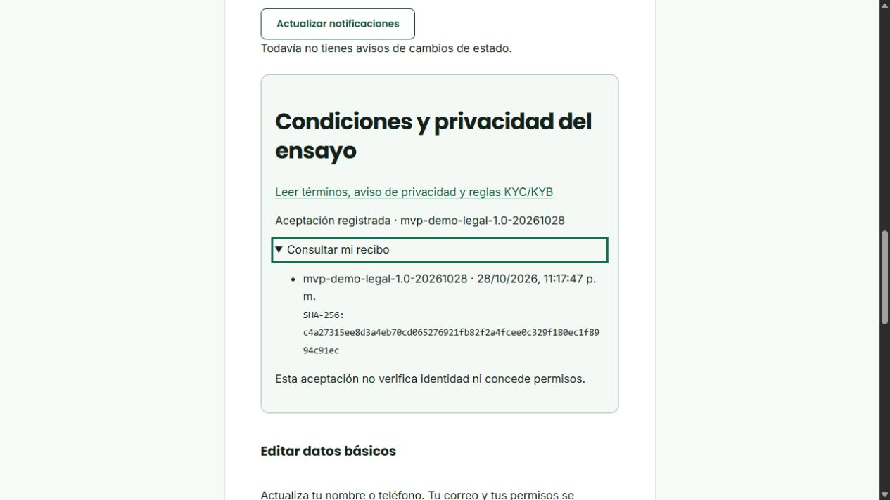

# S1-11, S2-06 y S2-07 · condiciones provisionales del MVP

**28/10/2026 · RicardoDev local · decisión de Ricardo con criterio del equipo.** Base `116d686`; implementación inicial `2ff1dff`, correcciones verificadas `8c96269`. Se conserva el trabajo integrado de Alison y Santiago. No hay push ni cambios en DEV/Trello.

## Qué se termina y bajo qué criterio

| Tarea / asignación original | Alcance que se completa |
| --- | --- |
| S1-11 / Alison · Condiciones del registro | Términos y privacidad propios, publicados y versionados; aceptación expresa, recibo exacto e integración transaccional en registro. Mayoría de edad declarada, sin afirmar comprobación real. |
| S2-06 / Santiago · Identidad de persona | Requisitos KYC sintéticos explícitos, documentos privados y revisión existentes, consentimiento básico y específico del caso, versión declarada y recibo por envío/corrección. |
| S2-07 / Santiago · Organización y KYB | Requisitos institucionales y de representación sintéticos, vínculos, destinos, aceptación/aprobación independiente existentes y el mismo registro de consentimiento por expediente/revisión. |

El responsable del cierre de las diferencias es Ricardo; se mantienen las asignaciones originales. Se sustituye el bloqueo por documentos externos no recibidos por un acuerdo interno **provisional para el MVP académico DEMO**. No se certifica autorización comercial, identidad/dinero reales ni aprobación jurídica externa. No se transforma una declaración de edad en verificación de edad.

## Documentos utilizables

1. [Condiciones del ensayo](legal/01_Condiciones_MVP_Provisionales.md).
2. [Aviso de privacidad](legal/02_Privacidad_MVP_Provisional.md).
3. [Requisitos de identidad, organización y destino DEMO](legal/03_Requisitos_KYC_KYB_DEMO.md).

Versión `mvp-demo-legal-1.0-20261028`. Huella del conjunto: `c4a27315ee8d3a4eb70cd065276921fb82f2a4fcee0c329f180ec1f8994c91ec`. La API publica los mismos textos en `/condiciones`; `node scripts/export-legal.mjs` los exporta desde la fuente inmutable del servidor. No son tres archivos independientes que puedan divergir del formulario.

[ADR-016](decisiones/ADR-016-condiciones-provisionales-del-equipo.md) identifica responsable, fecha, fuentes oficiales, documentos requeridos, permisos, destino, conservación y límites. Sus referencias principales son la CPE (arts.21/130–131) y el DS1793 art.56; no se atribuye a esas fuentes la aprobación del prototipo ni los plazos internos elegidos.

## Funcionamiento verificable

- La publicación conserva contenido/hash; la app tiene solo SELECT sobre ella. Un texto alterado o ausente impide confirmar aceptación/registro. No se imprime ni transmite contraseña como parte del recibo.
- Registrar requiere `demoConsent:true` y `legalVersion` exacta declarada por el cliente. Usuario, perfil, rol básico, recibo y auditoría se confirman juntos; el fallo revierte toda la operación. No modifica `app_user.accepted_terms_at`: un timestamp sin versión no reemplaza la evidencia versionada.
- La migración no crea aceptaciones para cuentas existentes. Desde Mi cuenta, el titular lee, marca y confirma. Repetir no crea otro recibo básico. Historial propio y sin actor impuesto por el cliente. Cuenta bloqueada, rol vencido o AUDITOR no escriben; se comprueba después de las esperas mediante la autorización transaccional común.
- Enviar/reenvíar KYC/KYB requiere aceptación básica vigente y confirmación específica con `legalVersion` declarada, además de `policyVersion`. La interfaz enlaza exactamente la versión que transmite. Un cliente anterior no obtiene silenciosamente un recibo de textos nuevos.
- Cada envío válido registra caso, revisión de origen, política, texto/hash, actor y fecha. Una corrección/reenvío crea otro recibo y conserva el anterior. Reintentar una versión ya consumida no duplica el envío. Las instantáneas privadas SUBMIT enlazan su recibo; BEFORE_CHANGE conserva sus referencias anteriores. El historial permite consultarlas.
- Se conservan las políticas sintéticas anteriores y sus aprobaciones. No se reescriben expedientes, documentos, estados o consentimientos históricos por publicar estas condiciones. El consentimiento no concede roles ni aprueba identidad/destino.
- No se pueden editar/borrar directamente textos o recibos con el rol de la aplicación. La eliminación controlada del usuario/expediente padre elimina referencias asociadas por integridad; no existe borrado integral público ni se anuncia purga automática.

## Cómo demostrarlo

1. Abrir `/condiciones` sin sesión: consultar los tres documentos, versión y hash.
2. Ir a Registro: abrir el enlace versionado, completar datos de prueba y probar sin marcar aceptación. Debe impedir el registro. Aceptar explícitamente y guardar; solo entonces aparece confirmación real.
3. Entrar a Mi cuenta → Condiciones y privacidad. Consultar el recibo y recargar: conserva fecha/versión/hash. En una cuenta anterior no aparece aceptado hasta confirmarlo personalmente.
4. Mi verificación → iniciar expediente propio → completar campos DEMO/PRUEBA y archivos sintéticos privados. Los requisitos siguen viniendo de la política activa de PostgreSQL.
5. Sin aceptación básica vigente, presentar se rechaza; el expediente no pasa a pendiente. Con ella, confirmar la política del caso y versión legal mostradas, y enviar. No queda aprobado automáticamente.
6. Un revisor independiente puede pedir información. El titular corrige y reenvía. Abrir Estados y versiones anteriores: ambos envíos tienen recibos distintos, con versión y huella; no se sobrescribe el primer consentimiento.
7. Repetir para organización: KYB_LEGAL requiere registro/constitución y tributario/no aplicabilidad; KYB_REPRESENTATIVE requiere autorización sintética. La representación formal conserva propuesta → aceptación autenticada → aprobación independiente y renovación KYB donde corresponde. FINANCE revisa por separado el destino ficticio.
8. Solicitud sobre datos: Mis incidencias → Otro → asunto Privacidad. No adjuntar documentos reales ni contraseñas; la atención y decisión quedan registradas por soporte. Borrado/archivo/retención requieren intervención del responsable, no un resultado automático ficticio.

## Pruebas y correcciones de revisión

Revisión independiente única de todo el cambio: tres hallazgos importantes, corregidos con reproducción rojo→verde:

- Versión específica ausente: antes200 y recibo inferido; ahora 400, sin envío.
- Reenvío: antes un recibo para dos envíos; ahora uno por revisión, ambos enlazados a su instantánea y con hash/versiones conservados.
- Bloqueo de cuenta durante espera real PostgreSQL: antes200; ahora 403 y ningún recibo nuevo.

Ensayo dirigido de seis escenarios PostgreSQL/HTTP: consentimiento/rollback, bloqueo concurrente, registro, KYC/KYB, captura/corrección y representación formal. Frontend 252 pruebas y backend 239 + 8 ADMIN, lint/tipos/builds aprobados. La regresión completa y sus cantidades se consolidan al final de este documento tras terminar; no se suman repeticiones focales como pruebas distintas.

Navegador: registro con aceptación, cuenta previa sin aceptación supuesta, aceptación desde Mi cuenta, persistencia tras recarga y apertura del recibo con teclado; consola sin errores en ese recorrido. Estructura de documentos y ausencia de desbordamiento a375/768/1440px comprobadas. No hay baseline de regresión visual ni auditoría axe completa: esa certificación se considera **inconclusa**, y no se declara accesibilidad integral ni medidas Core Web Vitals a partir de este ensayo. La revisión global continúa en S3-19.

## Instalación y conservación

Nueva instalación en contenedor propio y puerto 15448: SQL oficial → 40 migraciones → preparación S2 → verificación → activación; segunda migración sin pendientes, cinco categorías y una publicación, cero aceptaciones/campañas/casos previos. No copiar configuración privada ni cargar SQL adicional para las condiciones.

La base original se respaldó antes de migrar a 40. Un control previo de comparación se detuvo por exigir un campo de nombre de proyecto ausente en la configuración histórica; la migración se ejecutó antes de obtener la comparación inicial. Se restauró entonces el respaldo en una base aislada, sin API ni ensayos de escritura sobre esos datos, y se compararon sus **114 tablas anteriores** con la original actual: filas/valores idénticos. El inventario oficial de 59 tablas públicas se conserva. Los textos/tablas nuevos no producen aceptaciones retroactivas. El respaldo y las huellas se guardan fuera de Git; no se publican datos ni credenciales.

README§41 contiene los comandos para instalación/actualización. Contrato 0.15 y 215 rutas. API y proxy originales devuelven readiness200 y la publicación con su huella. Gmail privado sigue configurado; no se enviaron mensajes nuevos de prueba al integrar estos textos.

## Pendientes que no se cierran por estas tres tareas

S3-19 (QA global de interfaz), S3-20 (entrega general/publicación autorizada), S3-21 (recorrido y aceptación integral) y S3-26 (aceptación transversal de contactos/avisos). Ya no dependen de esperar textos externos para el criterio académico adoptado. Mantener controles y completar su evidencia propia. La futura operación comercial exige una evaluación distinta del operador, documentos y reglas reales.

## Consolidado final

| Verificación | Resultado |
| --- | --- |
| Frontend · lint/tipos/pruebas/build | 252/252, sin errores; persiste el aviso no bloqueante de tamaño del bundle. |
| Backend · lint/tipos/pruebas/build | 239/239 y 8/8 del ADMIN local. |
| Suite completa HTTP/PostgreSQL | **52/52**, sin fallos, omisiones ni cancelaciones; contenedor QA exclusivo, puerto 15448, DEMO y reinicio PostgreSQL. |
| Contratos / instalación |215 rutas,40 migraciones, segunda ejecución sin pendientes, cinco categorías. |
| Datos previos |114 tablas anteriores con contenido idéntico al respaldo restaurado; ningún consentimiento retroactivo. |
| Interfaz |Publicación, registro, aceptación propia, persistencia tras recarga y teclado; tres tamaños sin desbordamiento. |

**551 pruebas distintas aprobadas**. Las seis repeticiones dirigidas y los ensayos rojo→verde no se suman. Código `8c96269`; posteriores cambios solo de documentación/evidencia. [Resumen verificable](evidencias/legal-provisional/verificacion.json). Los logs y backups completos permanecen privados/locales.

**S1-11, S2-06 y S2-07 tienen cierre técnico bajo la política provisional propia del equipo para el MVP académico.** La planificación local queda en 32/36; permanecen S3-19/20/21/26. Sin push, cambios en DEV/Trello, aprobación jurídica externa ni autorización para operar dinero/identidades reales.
