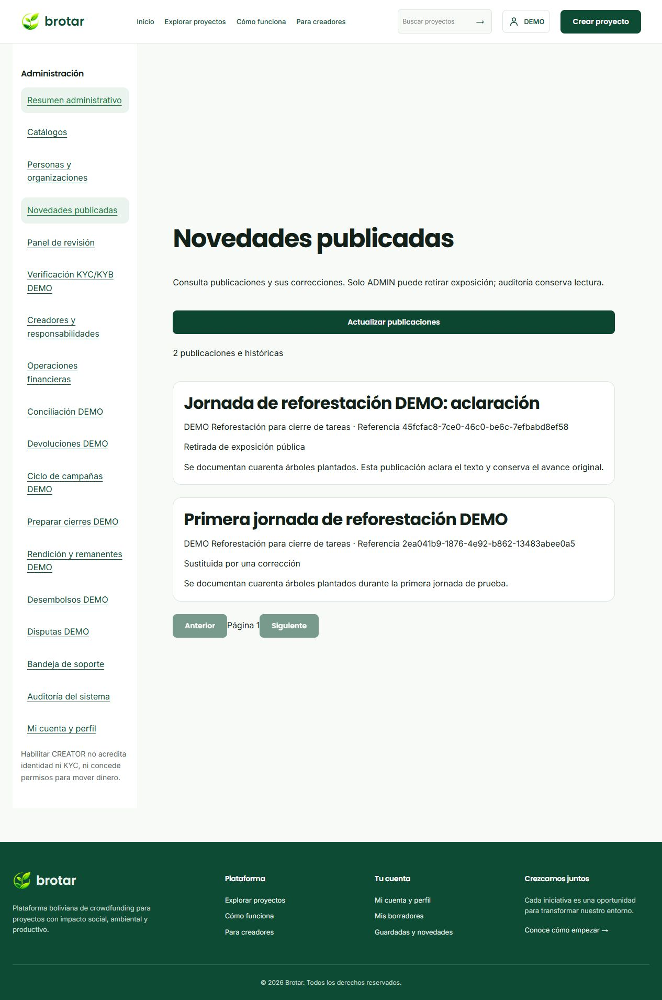
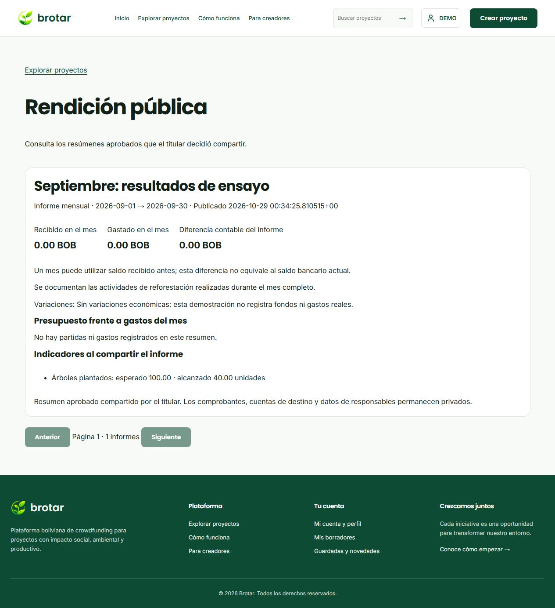
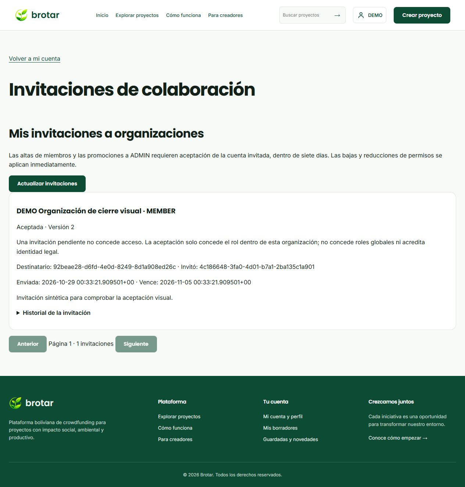

# S3-12, S3-13 y S3-14 · cierre técnico local

Fecha: **28/10/2026** · Rama: **RicardoDev** · Entorno: **MVP DEMO**. Base: integración `8e7405d`; implementación inicial `4e33061`, seguida de correcciones y compatibilidad en `fba9776`. Se conserva la base de Santiago y lo integrado de Alison/Ricardo. **Sin push ni cambios en DEV/Trello. Legal pendiente.**

## Resultado y criterios

| Tarea original de Santiago | Alcance integrado y completado en este incremento | Evidencia principal |
| --- | --- | --- |
| S3-12 · Publicar avances y seguimiento (BG-07/33/51) | Avances sobre actividades/hitos, fechas reales, responsables, porcentajes y resultados según unidad; novedades/borradores, evidencia/captura, recompensas y feed existentes. Corrección nueva referenciada e inmutable, una sucesora y reintento; retiro propio/ADMIN e historial. | `publication-succession.integration.test.ts`, `progress-publication.integration.test.ts`, `campaign-progress.integration.test.ts`; UI de avances y moderación. |
| S3-13 · Registrar rendición y cierre (BG-52) | Borradores y revisiones de meses terminados, gastos categorizados/partidas, fondos/variaciones/evidencias privadas, revisión independiente y remanentes. Final acumulativo sin duplicar gastos, incluso con más de 100 gastos aprobados. Resumen aprobado compartido expresamente; comparación e indicadores congelados, tipo mensual/legado/final y retiro administrativo. | `accountability.integration.test.ts`, `accountability.test.ts`, cliente/SSR y recorrido visual público. |
| S3-14 · Administrar personas y organizaciones (BG-54) | Datos permitidos, restricciones/sesiones, representación y auditoría existentes. Altas/promociones por invitación aceptada, cancelación/rechazo/caducidad, paginación/historial y permisos vivos tras esperas; sin conceder roles globales. | `organization-invitations.integration.test.ts`, `party-management.integration.test.ts`, `party-locking.integration.test.ts`; bandeja propia. |

Las reglas concretas y sus costos están en [ADR-015](decisiones/ADR-015-cierre-avances-rendicion-colaboradores.md). Cierre técnico de estas tarjetas no equivale a aceptación integral del MVP ni aprobación legal.

## Cómo demostrar S3-12

1. Entrar con CREATOR vigente y una campaña propia publicada o en ejecución. Ir a **Panel del creador → proyecto → Avances**.
2. Completar responsables, estados, fechas reales y porcentaje. Completar exige 100% y fecha final. Probar porcentaje 101, fecha futura, fin anterior al inicio y resultados fraccionarios para personas/familias/unidades: se rechazan. Los porcentajes alcanzados tampoco superan 100.
3. Guardar una novedad o revisar/publicarla. Consultarla públicamente y desde Guardadas/novedades de quien sigue la campaña. Los borradores/motivos privados no se exponen.
4. En **Gestionar publicación e historial**, corregir texto y explicar el motivo. Revisar y confirmar. Deben verse original intacto, referencia a la nueva publicación y nueva UUID; el feed solo muestra la vigente. Un reintento idéntico recupera la sucesora; una corrección incompatible sobre la versión antigua devuelve 409.
5. Con ADMIN ir a **Administración → Novedades publicadas**, escribir motivo y confirmar retiro. El contenido/historial se conservan en privado; ya no figura en novedades públicas/feed. REVIEWER/AUDITOR consultan sin botón de retiro ni facultad de escribir por HTTP.



Las imágenes cargadas ya eran públicas y sus URLs no se revocan con el retiro del texto. El retiro tampoco cancela una campaña, altera aportes o registra gastos.

## Cómo demostrar S3-13

1. Utilizar una campaña en ejecución, con inicio real y desembolsos DEMO completados si habrá gastos. Abrir **proyecto → Rendición**.
2. Crear informe periódico y seleccionar **un mes ya terminado**. Se calculan sus límites en Bolivia. Ejemplo: ejecución 13/agosto → primer informe 13–31/agosto. Septiembre → 1–30/septiembre. En octubre todavía no se rinde octubre.
3. Si la ejecución comenzó este mes, se explica cuándo estará disponible el primer informe. El cierre anticipado sigue disponible mediante **Preparar cierre acumulativo DEMO**. No crear un mes abierto solo para ensayar un formulario.
4. Completar nombre, resultados (20–5000), variaciones (20–2000), gastos (hasta 100), categoría activa/partida coherente, importe positivo exacto con hasta dos decimales, fecha real dentro del período y hasta tres evidencias privadas distintas por gasto. Puede guardarse borrador sin evidencia; no presentarse/aprobarse así.
5. Guardar, volver y editar. Las revisiones anteriores conservan documentos. Probar fechas futuras, campos adicionales, cantidades no decimales exactas, evidencia ajena/pública/repetida, exceso de fondos, mes duplicado y períodos superpuestos: se rechazan.
6. Presentar y revisar desde una cuenta independiente REVIEWER/ADMIN en **Administración → Rendición**. Pedir correcciones o aprobar. Aprobado queda inmutable. FINANCE tramita remanentes por separado, con evidencia/autoridad y sin convertirse automáticamente en aprobación de rendición.
7. El informe aprobado permanece privado. El titular revisa los textos, marca el consentimiento público adicional, selecciona compartir, escribe motivo y confirma. La respuesta y nueva consulta deben confirmar publicación.
8. Abrir **Consultar resumen**. Ver período/tipo, recibidos/gastados/diferencia, presupuesto total frente a gasto del informe e indicadores esperados/alcanzados. No deben aparecer comprobantes, cuentas de destino, identificadores personales ni motivos de revisión.
9. ADMIN puede retirar exposición desde la rendición administrativa. El resumen desaparece de consulta anónima, conservando aprobación e historia. El retiro no se deshace con una nueva clave de publicación.
10. Preparar el final acumulativo y su revisión/cierre. Conserva las fuentes aprobadas por referencia; los gastos finales no se vuelven a sumar a los mensuales. El resumen final se rotula **acumulativo: no sumar con mensuales**.

Los informes previos al corte mensual se muestran como **históricos/legados**, mantienen exactamente sus fechas y solo se corrigen dentro de ese período. Su resumen se describe como gasto del período, sin fingir periodicidad mensual. La diferencia recibidos−gastos del informe puede ser negativa si se utilizó saldo previo; no representa el saldo bancario actual.



## Cómo demostrar S3-14

1. La cuenta destinataria copia su UUID desde **Mi cuenta**. OWNER abre sus organizaciones y consulta miembros.
2. Invitar esa cuenta como MEMBER o ADMIN, con motivo/confirmación y versión actual. ADMIN/LEGAL_REPRESENTATIVE institucional solo invita MEMBER.
3. La confirmación dice **invitación registrada**; no aparece una membresía nueva vigente ni se concede acceso. Una promoción pendiente tampoco cambia el rol actual.
4. Destinatario entra con su propia sesión y abre **Mi cuenta → Invitaciones a organizaciones**. Ve rol, organización, remitente, motivo y vencimiento; selecciona aceptar o rechazar y confirma con motivo.
5. Tras aceptar se crea la membresía efectiva y queda el historial. Recargar conserva el resultado; repetir una versión resuelta devuelve conflicto y no crea otro vínculo. No aparecen roles globales nuevos.
6. Probar cuenta ajena, remitente intentando aceptar por otro, AUDITOR, confirmación falsa, HTML/controles, rol no permitido, invitación duplicada o vencida: no otorgan acceso. El gestor/remitente puede cancelar una pendiente; aceptar y cancelar simultáneamente tienen un único resultado.
7. Bajas y reducciones de permisos son inmediatas y conservan vínculos anteriores. La representación/propiedad sensible mantiene su flujo independiente de propuesta → aceptación → aprobación administrativa; no se obtiene con una invitación ordinaria.
8. Las pruebas automatizadas retienen un bloqueo real de membresía: si vence la invitación o la membresía del remitente durante la espera, el resultado es 409 y la cuenta sigue sin ADMIN.



## Instalación, datos y contratos

- **39 migraciones**: se añaden `PublicationSuccession1793145600000`, `MonthlyPublicAccountability1793145600001`, `OrganizationInvitations1793145600002`. Registradas en migrador/readiness, sin modificar el SQL oficial ni sincronizar esquemas automáticamente.
- **212 rutas HTTP**, inventario versión `sprint3-demo-0.14`. Cliente y API deben instalarse del mismo corte. Nuevas rutas de moderación, resúmenes e invitaciones tienen sesión/permisos, origen en escrituras, límites, versiones y diarios donde corresponde.
- Instalación aislada desde cero en `brotar-cierre-clean-qa-20261028`, puerto 15445: SQL oficial → migraciones → preparación S2 → verificación → activación. Segunda migración: sin pendientes. Cinco categorías disponibles desde la preparación normal; no hay paso de categorías oculto.
- Base personal: respaldo `brotar-before-cierre-s312-314-20261028.dump` fuera de Git; actualización de 36 a 39 y verificación del inventario oficial (59 tablas públicas). Comparación de filas y valores de las **109 tablas anteriores**, usando sus columnas previas; se añaden estructuras sin sobrescribir datos.
- Ningún `.env`, clave SMTP, cookie o backup se incluye en el repositorio. Las capturas usan únicamente la copia QA y datos sintéticos.

## Verificación y revisión final

Checks de frontend/backend y regresión PostgreSQL: **resultado consolidado en el bloque de cierre al final de este documento**. Las pruebas escriben únicamente en QA con nombre/puerto/configuración propios; nunca habilitar `ALLOW_DB_TEST_WRITES` en la base personal. La suite completa requiere una instalación QA sin campañas/casos/archivos previos ni agregados de retención: esos escenarios crean y retiran sus propios datos sintéticos. La campaña usada para capturas se conserva en otra copia; no se desactiva la protección de retención para reutilizarla como base de pruebas.

Comandos de calidad, cada uno desde su carpeta:

```powershell
# Raíz del frontend
bun run check
# backend/
corepack.cmd pnpm run check
node scripts/check-http-contracts.mjs
# Solo backend/ de una copia QA aislada preparada y activada
$env:ALLOW_DB_TEST_WRITES='true'
$env:DEMO_PAYMENTS_ENABLED='true'
$env:DB_TEST_RESTART='true'
corepack.cmd pnpm run test:integration
```

Revisión independiente única del cambio completo, seguida de una pasada de correcciones con reproducción rojo→verde:

- **Mes abierto:** reproducción unitaria y negativa HTTP; ahora se exige mes terminado y límites completos al presentar/aprobar.
- **Invitación/autoridad vencidas durante espera:** reproducción real PostgreSQL (antes aceptaba con 200); revalidación posterior y transición SQL condicionada, con rollback de cualquier alta.
- **Clasificación legada:** se considera importante por el riesgo de presentar gastos de varios meses como mensuales; proyección tipada y rótulos privados/públicos conservan el período real.

Decisiones que la revisión dejó al responsable: documentación/cierre se completan con evidencia; las imágenes anteriormente públicas conservan sus URLs por compatibilidad con otras publicaciones. No se halló un flujo que reabriera una aprobación final ya definitiva; no se añadió una reversión financiera hipotética.

## Límites y pendientes que permanecen

Legal definitivo (S1-11), su integración final KYC/KYB (S2-06/07) y aceptación transversal S3-19/20/21/26 siguen fuera de este cierre. Gmail privado existente se conserva; las pruebas usan transporte controlado y la copia visual no tiene credenciales SMTP. No se simula autorización bancaria ni jurídica. El tablero Trello y las ramas remotas no se modifican en este trabajo.

## Resultado consolidado del cierre

| Verificación final | Resultado |
| --- | --- |
| Frontend: lint, tipos, pruebas y build | 247/247 pruebas; comandos sin errores. El build conserva el aviso de tamaño del bundle, sin impedir su generación. |
| Backend: lint, tipos, pruebas y build | 236/236 unitarias y 8/8 de ADMIN local; comandos sin errores. |
| Regresión completa HTTP/PostgreSQL | **50/50**, sin fallos, cancelaciones ni omisiones; `brotar-final-cierre-qa-20261028`, puerto 15446, exclusivamente QA y DEMO. |
| Contratos / migraciones | 212 rutas; 39 migraciones; repetición sin pendientes y cinco categorías disponibles. |
| Conservación de la base original | Respaldo privado y comparación idéntica de las filas/valores de sus 109 tablas previas tras migrar. |
| Navegador | Corrección referenciada, retiro administrativo, resumen público consentido e invitación aceptada/persistida. Capturas sintéticas adjuntas. |

**541 pruebas distintas aprobadas**; las repeticiones focales no se suman. El primer ensayo general dio 46/50: se corrigieron dos fixtures de invitación y la compatibilidad del mensaje de migraciones, y se separó el almacén QA interrumpido con archivos incompletos. La repetición focal dio 6/6. El segundo intento general se detuvo al detectar una campaña visual activa incompatible con la precondición de retención. El resultado final 50/50 corresponde a una tercera instalación vacía, no a la suma de ejecuciones parciales. Los 69 metadatos incompletos del QA antiguo precedían la regresión final; la validación de integridad no se relajó.

El código ensayado coincide con `fba9776`; las modificaciones posteriores son documentación/estado local. El [resumen verificable](evidencias/cierre-s312-314/verificacion.json) registra alcance, cantidades y hash del log de integración. Los logs y backups completos permanecen privados/locales. **S3-12, S3-13 y S3-14 tienen cierre técnico en el MVP DEMO.** No hay push, cambio de DEV/Trello ni aceptación legal/global.
