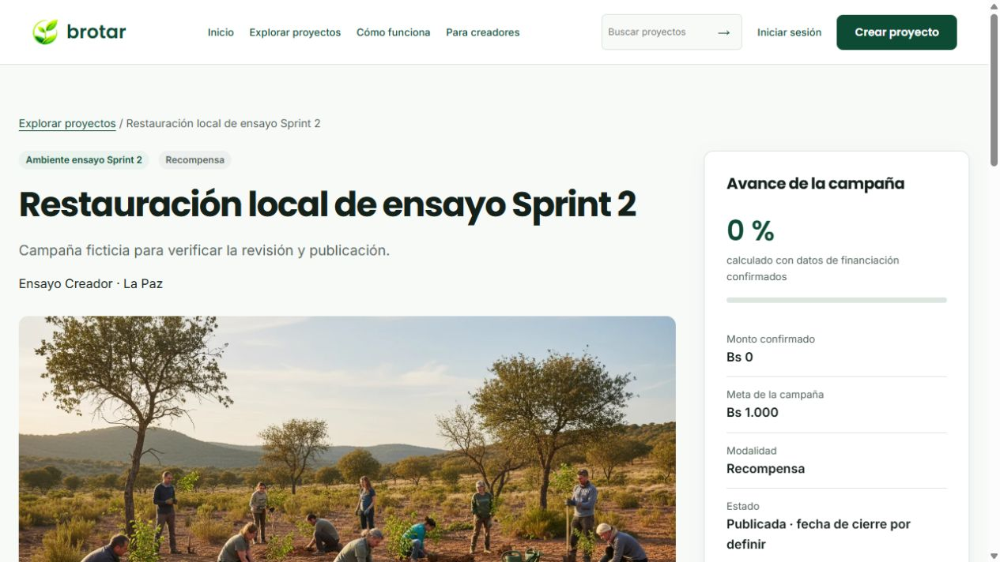
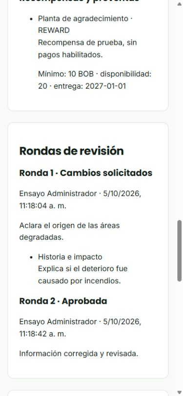

# Verificación técnica del Sprint 2 de Brotar

Fecha de verificación: 05/10/2026. Rama local: **RicardoDev**. Destinatarios: equipo, docente y líderes. Alcance: las 13 tareas vigentes de campañas de Fase 3, sobre la base integrada del Sprint 1. Fuente: [tarea oficial](requisitos/Brotar_Tarea_Fase3_Modulo_Campanas.pdf) y [planificación](planificacion-sprints.json).

El incremento está implementado y comprobado localmente: una campaña se guarda, envía, revisa, corrige, aprueba y publica mediante frontend/API/PostgreSQL; el visitante consulta únicamente publicaciones. **No hay commit/push de este corte ni cambios en DEV/main/Trello.** La aceptación formal de los líderes, y por tanto el último criterio externo de S2-21, siguen pendientes. Este resultado no cierra todas las historias del MVP ni certifica ausencia de errores.

## Tareas y resultados verificables

El reparto se conserva: Santiago 7, Alison 1 y Ricardo 5. Los criterios de abajo corresponden al incremento, no a módulos futuros incluidos en historias generales BG.

| Tarea y responsable | Implementación y resultado técnico | Demostración |
| --- | --- | --- |
| S2-02 Santiago · Planificar actividades e hitos | Actividades con responsable/fechas, hitos vinculados cuando corresponda; validación y persistencia por propietario | Constructor → Plan y presupuesto → guardar planificación, volver y recuperar |
| S2-03 Santiago · Presupuesto y riesgos | Partidas con importes positivos, total calculado, riesgos/mitigación; guardado separado sin imponer meta = presupuesto | Añadir gasto y riesgo, guardar presupuesto; importe inválido no persiste |
| S2-04 Santiago · Financiamiento | Meta positiva, moneda activa, duración/modelo y fechas coherentes, sin activar pagos | Guardar meta; recargar y comprobar; categoría/moneda inactivas no pasan completitud |
| S2-05 Santiago · Recompensas/preventas | Tipo, descripción, mínimo, disponibilidad y entrega; donación omite el paso, sin perder datos históricos | Guardar recompensa; cambiar modalidad a donación y comprobar omisión |
| S2-10 Santiago · Revisión final | Resumen persistido y faltantes específicos enlazados a su paso | Revisión y envío → abrir un faltante y corregirlo |
| S2-11 Santiago · Enviar a revisión | Propiedad, REGISTERED_USER + CREATOR, completitud y estado; fecha/actor/ronda con bloqueo transaccional | Enviar → IN_REVIEW; segundo envío no duplica ronda ni permite editar |
| S2-12 Ricardo · Decisiones | ADMIN consulta todas las secciones y decide aprobar, rechazar con motivo o solicitar cambios; responsable, comentarios y observaciones persistidos | Cola administrativa → detalle completo → decisión → confirmación → historial |
| S2-13 Santiago · Corregir y reenviar | Solo propietario en CHANGES_REQUESTED; muestra última ronda, corrige y crea nueva ronda conservando anteriores | Mis proyectos → Corregir campaña → guardar → reenviar |
| S2-14 Ricardo · Estados/publicación | DRAFT, IN_REVIEW, CHANGES_REQUESTED, APPROVED, PUBLISHED y REJECTED; aprobación privada, publicación separada y rechazo no público | Aprobar → todavía no aparece en Explorar; Publicar y confirmar → visitante puede verla |
| S2-15 Ricardo · Proyectos propios | Lista/detalle, continuidad de campaña concreta, acciones por estado y descarte lógico solo DRAFT propio con confirmación | Mis proyectos → continuar; descartar otro borrador y comprobar historial |
| S2-16 Alison · Catálogo real | Lista/detalle anónimos reales, portada pública, búsqueda/filtros, historia, impacto, meta/avance y recompensas aplicables; vacío/error sin muestra de respaldo | Sin sesión → Explorar → combinar filtros → abrir publicación |
| S2-17 Ricardo · Cola administrativa | Acceso ADMIN, búsqueda/estados, detalle y carga/vacío/error/reintento; aprobadas pendientes de publicación permanecen en cola | Usuario común no accede; ADMIN abre revisión y luego publica la aprobada |
| S2-21 Ricardo · Pruebas/documentación | Recorrido integrado, errores, roles/propiedad, concurrencia, persistencia, móvil/teclado, README/contratos/evidencia | Repetir comandos y tutorial de este informe; publicación de código y revisión externa aún pendientes |

## Implementación administrativa añadida en este corte

Se conservaron los módulos de Alison y Santiago, el acceso del Sprint 1, TypeORM y la arquitectura de capas. El dominio [administrative-review.ts](../backend/src/campaigns/domain/administrative-review.ts) normaliza decisiones/motivos y limita rondas/observaciones. El [caso de uso](../backend/src/campaigns/application/administrative-review.ts) depende de un puerto, no de SQL o NestJS. El [controlador](../backend/src/campaigns/infrastructure/administrative-review.controller.ts) valida UUID, DTO y ADMIN; las mutaciones reutilizan el control de origen y sesión existente.

El [repositorio](../backend/src/campaigns/infrastructure/typeorm-administrative.repository.ts) reúne información general, ubicación/organización, historia/indicadores, portada, actividades/hitos, partidas/riesgos, financiamiento, recompensas, rondas y observaciones. La lectura usa una transacción REPEATABLE READ y consultas secuenciales con el mismo administrador de entidad para evitar mezclar snapshots.

Al decidir/publicar, se bloquean campaña y última ronda. Se exige estado/ronda vigente, se valida nuevamente completitud antes de aprobar/publicar y se actualizan decisión/estado/historial de forma atómica. Se reutiliza el trigger oficial de historial y se añade motivo/metadatos a su registro, sin inventar una segunda entrada. El actor procede de la sesión, nunca del cuerpo enviado. Solicitudes concurrentes producen un éxito y un conflicto, no dos decisiones.

La [vista administrativa](../src/features/campaigns/AdministrativeCampaignPanel.tsx) muestra toda la información, faltantes, motivo obligatorio, observaciones por sección, confirmación, carga y resultado. Los [contratos del cliente](../src/features/campaigns/administrativeClient.ts) verifican respuestas anidadas y que identidad/estado/ronda coincidan con la operación solicitada. Una respuesta incierta exige actualizar antes de decidir otra vez, evitando un falso mensaje de éxito. Las etiquetas distinguen decisión histórica de ronda de estado público actual.

## Contratos HTTP

Todas las rutas tienen prefijo `/api`. La lectura administrativa requiere ADMIN; las escrituras requieren además origen/cabecera de mutación válidos y se devuelven con no-store.

| Operación | Contrato |
| --- | --- |
| GET `/admin/campaigns/:id/detail` | Proyecto completo, secciones, `rounds`, `missing` y `publicationEnabled` |
| POST `/admin/campaigns/:id/decision` | `{decision, comment, expectedRound, observations}`; decision = APPROVED, CHANGES_REQUESTED o REJECTED |
| POST `/admin/campaigns/:id/publish` | `{confirmed: true, expectedRound}` |

Una observación tiene `{section, fieldPath, message}`. Section pertenece a general, modality, story, cover, plan, budget, funding o rewards; fieldPath puede ser null. El comentario es obligatorio en rechazo/cambios. Si la solicitud de cambios no trae observaciones, su comentario queda como observación general visible al creador. No se aceptan observaciones en aprobación/rechazo, campos extra, motivo vacío, ronda no entera o límites excedidos.

Resultados: 200 con identidad/estado/ronda; 400 para entrada inválida; 401 sin sesión; 403 sin rol/origen o publicación deshabilitada; 404 si no existe campaña accesible; 409 si cambió ronda/estado; 422 con faltantes seguros si no está completa. Los detalles internos de SQL no se muestran al usuario.

## Persistencia y migración

La base local vigente es PostgreSQL V2 en Docker, `brotar_db`, puerto anfitrión 15433. NestJS y Vite continúan fuera de Docker. Se preserva el SQL oficial con su hash y los datos locales anteriores.

La [migración CampaignRejected](../backend/src/shared/infrastructure/database/migrations/1791244800000-CampaignRejected.ts) complementa únicamente el enum de campaña con REJECTED, requerido por Fase 3 y ausente de la base original. El enum de decisiones existente no sustituye ese estado. El control de migraciones vive fuera de public; permanecen 59 tablas públicas. El rol de API no obtiene DDL. [grant-s2-review.sql](../infra/postgres-v2/grant-s2-review.sql) añade solo permisos técnicos de revisión/observaciones/historial.

Se probó la migración sobre una **base temporal nueva desde el SQL oficial**, conservación de catálogos, uso del valor, repetición de up y rechazo de down inseguro. PostgreSQL no ofrece eliminación simétrica segura de un valor ENUM; no se borran/reclasifican campañas para simular reversión. Consultar [procedimiento de recuperación](../infra/postgres-v2/MIGRACIONES.md) antes de aplicar en un entorno compartido.

## Verificación automatizada del 5 de octubre

| Conjunto | Aprobadas | Fallidas | Omitidas |
| --- | ---: | ---: | ---: |
| Frontend | 122 | 0 | 0 |
| Backend sin base | 123 | 0 | 0 |
| Integración PostgreSQL | 18 | 0 | 0 |
| Total | 263 | 0 | 0 |

Lint, tipos y compilaciones también aprobaron. Estos conteos incluyen regresiones del Sprint 1; no son 263 historias ni una certificación de seguridad absoluta. Los registros anteriores de 248 casos pertenecen al corte previo al módulo administrativo y se conservan como antecedentes.

Pruebas específicas: [dominio/aplicación](../backend/test/administrative-review.test.ts), [HTTP](../backend/test/administrative-review-http.test.ts), [frontend/contratos/vista](../tests/administrative-campaigns.test.ts), [flujo PostgreSQL completo](../backend/integration/campaign-sections-submission.integration.test.ts), [migración aislada](../backend/integration/migrations.integration.test.ts), [proyectos/cola](../backend/integration/projects.integration.test.ts) y [catálogo](../backend/integration/public-campaigns.integration.test.ts).

La integración completa utiliza APIs reales para crear secciones, enviar, solicitar cambios, corregir/reenviar, aprobar, publicar y rechazar otra campaña. Comprueba falta de sesión/roles, origen, DTO inválido, propiedad, rondas obsoletas, solicitudes concurrentes, rollback ante categoría deshabilitada y persistencia tras reiniciar la API. APPROVED/REJECTED no aparecen públicamente; PUBLISHED sí. SQL se usa para fixtures controlados (roles/catálogos) y comprobación, no para sustituir decisiones del producto.

### Repetir los comandos

Desde raíz: `bun run check`. En backend, con pnpm 11.19.0: `pnpm run check`. En el equipo de esta revisión el pnpm global era distinto; se ejecutaron los mismos pasos individualmente con `corepack pnpm run lint`, `typecheck`, `test` y `build`, respetando la versión declarada, sin cambiar lockfiles ni instalar otra versión global.

Preparar PostgreSQL según la sección 15 del [README](../README.md), luego desde backend:

```powershell
$env:ALLOW_DB_TEST_WRITES='true'
$env:DB_TEST_RESTART='false'
try {
  node --env-file=../infra/postgres-v2/.env.backend --test --test-concurrency=1 dist-test/integration/*.test.js
} finally {
  Remove-Item Env:\ALLOW_DB_TEST_WRITES
  Remove-Item Env:\DB_TEST_RESTART
}
```

Compilar pruebas antes, mediante `pnpm run test` o `pnpm run check`. Solo usar la V2 local de desarrollo; las integraciones crean/limpian datos ficticios propios y rechazan destinos no previstos. DB_TEST_RESTART=false no ensaya un reinicio de contenedor en esta ejecución: sí se ensayaron reconexión y reinicio de API. Las pruebas de reinicio de contenedor de cortes anteriores no se presentan como recién repetidas.

## Ensayo manual de interfaz

Con cuentas temporales de ensayo se inició sesión por UI, se abrió el detalle completo y se solicitaron cambios con observación de historia. La corrección y el reenvío se realizaron por la API del creador; la aprobación y publicación utilizaron confirmaciones reales de interfaz. Se verificaron el error localizado por motivo vacío, cambio de estado, observación persistida, segunda ronda y publicación visible sin sesión. Las cuentas/campaña/catálogos/archivo generados para este ensayo se eliminaron después; no se modificaron roles de integrantes ni se dejó una cuenta ADMIN compartida.

Se comprobó el detalle público y panel administrativo en viewport móvil de 390 × 844 (área efectiva de contenido 375 px), sin desbordamiento horizontal. Tab y Enter permitieron acceder y actualizar la revisión. Se conservaron etiquetas, foco, mensajes y controles; esto es un ensayo acotado, no una auditoría completa de accesibilidad.





Las imágenes muestran datos ficticios ya limpiados. La URL de esa campaña de ensayo no debe considerarse un registro permanente ni una credencial para presentación. Para estudiar o presentar con datos actuales seguir el tutorial de nueve pasos del README, usando cuentas autorizadas por el responsable.

## Decisiones y cierre externo pendientes

1. **D05:** Ricardo autorizó provisionalmente ADMIN como actor de publicación. [ADR-005](decisiones/ADR-005-publicacion-administrativa-provisional.md) explica configuración y límites. Falta confirmación definitiva de líderes/cliente; no impide la demostración autorizada.
2. **D06:** provisión definitiva de roles y restricciones avanzadas. Los endpoints ya exigen los roles vigentes; el registro no escala privilegios. Para una presentación manual se requieren cuentas autorizadas de creador/administrador, no activar personas automáticamente por SQL.
3. **S2-21, aceptación externa:** falta publicar el incremento en el destino autorizado, obtener referencia del commit/PR final y revisión de alcance. Este informe es evidencia local, no una aprobación inventada. El HEAD base no representa las modificaciones todavía sin commit.
4. Correo, textos legales y reglas de verificación continúan con sus decisiones anteriores. Checkout/aportes, pagos, KYC/KYB, desembolsos y rendición quedan fuera de Fase 3. No se trasladaron esas tareas de Sprint 3 para inflar el cierre.

Conclusión: **13 tareas implementadas y verificadas técnicamente; 12 con cierre técnico funcional y S2-21 con verificación/documentación locales completas, pendiente de entrega/revisión formal**. La aceptación final del Sprint 2 requiere la presentación del incremento a los líderes, no solo este conteo.

## Revisión adicional de calidad y guías de estudio

Este apartado actualiza el corte local del 5 de octubre de 2026; los resultados anteriores se conservan como evidencia histórica. Los cambios siguen en `RicardoDev`, sin commit ni publicación de esta revisión en DEV/main o Trello.

### Correcciones y refactorización

- Importes: se corrigió el rechazo de valores válidos de dos decimales y se suman partidas mediante céntimos para evitar el caso `0.1 + 0.2`.
- Fechas: se rechazan días inexistentes, como el 31 de febrero, antes de guardar financiación.
- Texto: se rechaza NUL antes de persistir; se alinearon límites y errores de campos entre frontend y backend. El límite de 5000 caracteres es una protección técnica, no una regla comercial aprobada.
- Contraseñas: se conservaron hash/sesión y coincidencia exacta de Unicode y espacios; se verificaron Ñ, acentos y el límite de 128 puntos de código. No se normaliza ni recorta la contraseña.
- Administración y portada: se ajustó la respuesta de ronda inválida a error de validación y se rechaza NUL en el texto alternativo.
- UI: se añadió edición de las notas de presupuesto y se corrigió el rótulo de campaña rechazada.
- Responsabilidades: `useCampaignSections.ts` concentra carga, estado y guardado; `CampaignSectionsEditor.tsx` conserva la presentación. Se mantuvieron contratos, capas y arquitectura existentes.

### Verificación actual

| Suite | Aprobadas | Fallidas | Omitidas |
| --- | ---: | ---: | ---: |
| Frontend | 130 | 0 | 0 |
| Backend unitarias/HTTP | 128 | 0 | 0 |
| Integración PostgreSQL real | 18 | 0 | 0 |
| **Total** | **276** | **0** | **0** |

Lint, comprobación de tipos y compilación también pasaron. Las integraciones se ejecutaron secuencialmente y con escritura explícita de fixtures aislados; la limpieza afecta solo los datos de prueba. En este corte `DB_TEST_RESTART=false`: no se repitió el reinicio del contenedor. No debe confundirse con la prueba histórica de persistencia tras reinicio.

La comprobación interactiva adicional de navegador quedó bloqueada por la política de la herramienta. Se conserva la evidencia visual anterior; el nuevo hook se verificó mediante análisis estático, compilación, pruebas y renderizado inicial de carga, pero esto no sustituye repetir su ensayo interactivo. No se declara seguridad absoluta ni aceptación externa por estos resultados.

### Documentos entregables locales

- [Guía de demostración y estudio del Sprint 2](../output/pdf/Guia_Demostracion_y_Estudio_Sprint_2_Brotar.pdf): 19 páginas; cubre las 13 tareas, criterios, ubicaciones, pruebas, escenarios negativos y recorrido por roles.
- [Informe de principios y patrones del Sprint 2](../output/pdf/Informe_Principios_y_Patrones_Sprint_2_Brotar.pdf): 15 páginas; agrupa KISS, DRY, YAGNI, SOLID, IoC, composición, Boy Scout, Repository/Adapter y defensa técnica por concepto.

Ambos PDF se generaron desde `scripts/build-sprint2-pdfs.py`, con referencias a archivos y líneas comprobadas, y se revisó visualmente la paginación. El README enlaza las guías. La publicación administrativa provisional sigue documentada en ADR-005; las reglas definitivas y la revisión/entrega formal permanecen pendientes.
