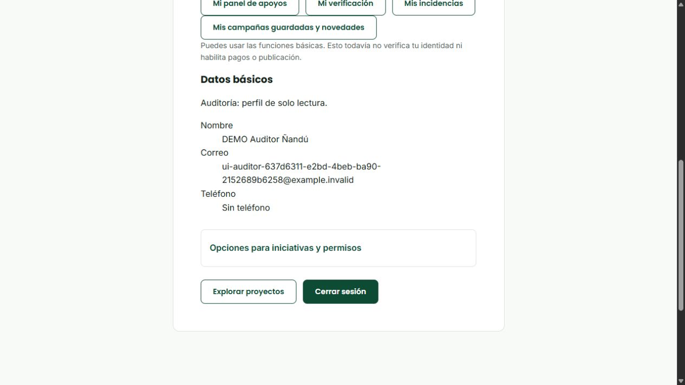

# Integración transversal del Sprint 3 · S3-15, S3-16, S3-17 y S3-18

Fecha: 24/10/2026. Rama: RicardoDev, solo local. Responsable del incremento: Ricardo. S3-17 pertenece a Santiago: se preserva y revalida, sin reasignarla. Se completa el trabajo transversal sobre las funciones implementadas de este corte del MVP DEMO. No se cambia la definición del MVP ni se afirma que todas sus funciones estén desarrolladas. Correo real, textos legales y publicación continúan pendientes.

## Criterios y comprobaciones

| Tarea | Criterios aplicables | Implementación y comprobación reproducible |
| --- | --- | --- |
| S3-15 · Auditoría | BG-56: actor, fecha, acción, objeto, resultado; consulta restringida; secretos excluidos; retención definida | Auditoría transaccional de decisiones/operaciones existentes, captura de verificaciones, cuentas/perfil, organizaciones, archivos, guardados, avances, simulaciones y operaciones financieras. READ de documentos privados autorizados y EXPORT financiero antes de entregar respuesta. Consultas de audit_log/status_history separadas, filtros/cursor bigint, pruebas de rollback y contexto por transacción. |
| S3-16 · Permisos | BG-53: responsabilidades separadas, propiedad en API, auditor de lectura y roles compatibles | Política común en perfil; revalidación de cuenta/rol tras bloqueos en escrituras personales y de catálogos; límites por caso/documento. Matriz conocida filtra concesiones residuales de SQL. `parties.read`/`dashboard.read` separan permisos de consulta. Pruebas HTTP de nueve perfiles, auditor+ADMIN, revocaciones y caducidad durante espera real. |
| S3-17 · Parámetros | BG-55: solo claves acordadas, referencias protegidas y actor de cambios | Se conserva catálogo administrativo y las dos claves enteras de ADR-013: primera respuesta 48 horas (1–48), escalamiento 120 (72–720). ADMIN escribe, AUDITOR lee. Alertas leen valores persistidos. Se revalida tras esperar los bloqueos y se audita atómicamente. No se añaden parámetros comerciales ni modalidades. |
| S3-18 · Contratos/persistencia | BG-59/60/61: contratos coordinados, migraciones no destructivas, privacidad por caso y recuperación | Inventario de las 169 rutas reales, enlazado al check; DTO/cliente y regresión HTTP/PostgreSQL del corte completo. Migración incremental 28, readiness de matriz completa. Recuperación en copia aislada, inventario oficial, huellas de contenido antes/después de up, y ensayo explícito de binarios con tamaño/SHA-256. |

Esta tabla no cierra BG-12/BG-41 completas ni los paneles de otras tarjetas por haber probado permisos. Tampoco declara implementadas invitaciones/transferencias, edición de terceros/restricciones, soporte general, informes periódicos o logística pendientes. No fue necesario construir esos productos para instrumentar y proteger las operaciones existentes: el inventario y la regresión quedan como condición obligatoria de sus futuras integraciones, que no se aceptan automáticamente por este cierre.

## Auditoría y privacidad

- Se mantiene la tabla oficial `audit_log`, sin un historial paralelo. `setAuditActor` usa configuración local de transacción; no queda la identidad en la siguiente petición del pool. El helper usa el reloj real de PostgreSQL y registra solo metadatos cerrados `{source: APPLICATION, result: APPLIED}`. Un rol vigente capturado no equivale a una instantánea completa de todos los permisos.
- Altas/ediciones/bajas lógicas y decisiones se confirman junto a su auditoría. Un fallo al insertar auditoría revierte la escritura de negocio. Las claves idempotentes y las operaciones sin cambio no generan un segundo éxito. La baja de un guardado registra el UUID real del guardado retirado.
- Registro público solo crea REGISTERED_USER. LOGIN se registra tras autenticación válida; LOGOUT solo cuando se revoca efectivamente una sesión. Repetir salida no genera otra acción. La recuperación local audita el cambio efectivo sin guardar token ni hash. Esto no implementa correo.
- La creación y modificación de organización no copia ahora nombres/contactos al registro mínimo. Las revisiones/documentos y los informes conservan sus propios datos privados/versionados, separados del resumen de auditoría. No se borran los registros heredados que ya tuvieran textos libres; la consulta sigue excluyendo esos cuerpos.
- Un acceso autorizado a un binario privado genera READ **después** de autorizar el caso y comprobar bytes/tamaño/SHA-256, y antes de entregar respuesta. Fallar la lectura o el registro impide la entrega. No implica que el cliente haya recibido todos los bytes; no se inventa confirmación de recepción. Una exportación registra EXPORT después de preparar el CSV y revalidar `finance.read`, sin copiarlo al log.
- Los archivos KYC y de cierre mantienen descarga por expediente/campaña; ser administrador o conocer el UUID no concede acceso universal a un archivo ajeno. AUDITOR no obtiene documentación KYC por `audit.read`. Evidencias corruptas no se entregan ni se presentan como documentos válidos. Nombres de archivo con controles/caracteres Unicode inválidos se rechazan; Ñ y acentos normales se admiten.
- Auditoría conserva la política DEMO de 12 meses de ADR-012 y mantenimiento manual: plan por defecto, bloqueo conservador por trabajo/obligaciones activas, agregado mensual anónimo después del detalle elegible. La API no tiene UPDATE/DELETE sobre audit_log. No hay purga al arrancar ni aprobación legal de conservación de datos reales.

## Permisos e identificación de representación

La matriz aprobada de `ACCESS_POLICY` es el límite de los permisos conocidos. Se requieren tanto rol vigente admitido como concesión real de `role_permission`; una fila residual que asocie FINANCE.operate a ADMIN no convierte a ADMIN en operador financiero. FINANCE, SUPPORT, COMPLIANCE y REVIEWER mantienen responsabilidades distintas; las comprobaciones de independencia impiden aprobar o mover fondos propios. Las pruebas de esos módulos siguen en la suite completa.

Los cambios de perfil pasan por RoleGuard y revalidación dentro de la transacción; no basta una sesión antigua. AUDITOR permanece en lectura aunque acumule ADMIN. La interfaz del perfil espera la comprobación, muestra error/reintento si falla y presenta datos sin formulario de escritura al auditor. Ingreso/salida y recuperación de credenciales son operaciones de seguridad permitidas; registrar automáticamente una consulta/exportación no concede mutaciones de negocio al auditor.

La lectura de miembros, gestión propia de organizaciones y captura de verificación interpretan vigencia como `joined_at <= instante actual` y `left_at IS NULL OR left_at > instante actual`, coherente con el ciclo. Las comprobaciones repetidas tras bloqueos usan `clock_timestamp()`, evitando congelar una concesión hasta el fin de una transacción que empezó antes de su vencimiento. Se preserva historial de membresías; no se implementan aquí sus mutaciones generales pendientes.

## Contratos, instalación y recuperación

`docs/contratos-http-sprint3.json` enumera método/ruta/controlador, roles, permisos y guards de cada endpoint actual. `node scripts/check-http-contracts.mjs` compara el inventario con los metadatos reales de Nest, sin abrir puerto ni conectar a PostgreSQL. Rechaza rutas duplicadas o protegidas sin autorización/guard de origen en mutaciones. Las excepciones públicas y de autenticación son explícitas. Regenerar con `--write` exige revisión del diff; no sustituye pruebas de propiedad ni validación de payload. El check también se ejecuta desde los tests de backend usando la compilación de pruebas.

La migración 28 agrega solo los permisos `parties.read` y `dashboard.read` a ADMIN/AUDITOR. No modifica SQL oficial, cuentas, campañas ni concesiones de usuarios. Las 59 tablas oficiales, vistas, secuencias, enums, funciones, triggers y FK deben conservarse. No hay `synchronize`, reset o borrado del control. Readiness exige todos los pares permiso/rol de la matriz; una instalación incompleta devuelve 503, en vez de anunciar servicio listo.

`drill-recovery.mjs` conserva el respaldo fuera del repositorio, restaura en `brotar_db_drill_<aleatorio>`, verifica inventario/conteos y huellas de contenido de las tablas públicas/extensión/control antes y después de repetir up en la copia. Estas huellas prueban conservación de contenido en ese ensayo, no son una firma forense contra el administrador de PostgreSQL.

El modo `--with-files` añade recuperación a un directorio nuevo de todos los archivos activos que indique la **base restaurada**, a partir de `FILE_STORAGE_DIR` o `backend/private/files`. Comprueba ruta cerrada, tamaño, SHA-256 del origen y de la copia; no sobrescribe respaldos anteriores ni el almacén original. Si falta/cambia un archivo o hay metadatos no recuperables, el ensayo falla: la copia parcial queda para diagnóstico y no se declara éxito. Los archivos eliminados lógicamente permanecen sujetos a retención; este modo recupera los activos. Un dump de metadatos no contiene binarios. Los permisos numéricos de directorio son efectivos según el sistema operativo; en Windows se heredan además sus ACL, y la carpeta debe seguir privada y fuera de Git.

## Ensayo, incidencias y alcance

La prueba nueva `integrated-security.integration.test.ts` recorre nueve cuentas sintéticas y la matriz administrativa por HTTP, comprueba la denegación de un auditor con ADMIN, permisos residuales, readiness ante concesión faltante, rollback del perfil al fallar auditoría, caducidad mientras espera un bloqueo de PostgreSQL, privacidad/alteración de archivo y recuperación con binarios. El resto de la suite revalida campañas, identidad, soporte/disputas, ciclo, desembolsos, rendición, catálogos, reinicio e instalación desde el SQL oficial.

Comprobación adicional en navegador: cuenta sintética con AUDITOR en una pestaña independiente `localhost:5198`, API QA 3019. Ingreso desde formulario real → Mi cuenta → texto «Auditoría: perfil de solo lectura», **0 formularios de edición y 0 botones Guardar cambios**; consola sin errores JavaScript. Cerrar sesión volvió al ingreso. Se retiraron solo ese usuario/credenciales de prueba y los servidores/pestaña temporales, conservando la pestaña original del usuario. No se aplicó un viewport especial ni se afirma una nueva auditoría visual de todas las pantallas.

Incidencias detectadas/corregidas en este incremento:

1. Perfil autenticado sin RoleGuard: prueba reprodujo la brecha; se añadió guard y validación transaccional, manteniendo lectura para AUDITOR.
2. La primera prueba de salida detectó la forma `[filas, cantidad]` de UPDATE RETURNING en TypeORM. Se normaliza antes de atribuir el actor; prueba específica falló antes y pasó tras corregir. Sin revocación efectiva no se audita otra salida.
3. El primer ensayo llamaba al respaldo mediante un proceso síncrono y luego reutilizaba una conexión HTTP que había agotado su espera durante el bloqueo del event loop de pruebas. El respaldo del test pasa a proceso asíncrono; no se oculta el error con reintentos de producción.
4. En QA quedaron 49 binarios sintéticos huérfanos de ensayos anteriores: uploader eliminado, nombres DEMO conocidos y ninguna referencia de campaña/expediente/adjunto/perfil/soporte/recompensa. Tras respaldo se marcaron eliminados lógicamente **solo en esa copia aislada**. Se corrigió el cleanup del ensayo de ciclo para marcar sus propias cargas antes de retirar sus usuarios. No se tocó la base original ni se añadió una purga de aplicación.
5. Docker Desktop no iniciaba por sockets temporales de Windows inaccesibles. Se preservaron por renombrado los directorios temporales de comunicación y se recuperó el motor, sin Factory Reset ni borrar volúmenes. No es un comando normal de instalación del proyecto.
6. La regresión completa detectó dos incompatibilidades del incremento: una sustitución de texto alteró el alias SQL `mem` de una comprobación KYC y la marca APPLIED había anidado la instantánea de categorías cambiando sus claves históricas. Se corrigió el alias y se conservaron las claves originales, agregando metadatos sin moverlas. No se relajaron las aserciones previas; se repiten los casos y la suite completa después de corregir.

Resultados finales con el código corregido:

| Comprobación | Resultado |
| --- | --- |
| `bun run check` en trabajo | Lint, tipos, **217** pruebas y build aprobados; exit 0. |
| `corepack pnpm run check` en backend de trabajo | Lint, tipos, **211** pruebas, **8** ADMIN local y build aprobados; exit 0. |
| Suite completa HTTP/PostgreSQL de QA, `DB_TEST_RESTART=true` | **37/37**, **0** fallos, **0** omitidas, exit 0; 416458 ms. Incluye el corte actual completo después de corregir las consultas KYC, perfil y compatibilidad de auditoría. |
| Repetición dirigida previa del ciclo y revisión KYC/KYB | **2/2**, sin sumar otra vez esos casos al total. Persona y organización, desembolsos/cierre y documentos/revisión reales por HTTP. |
| Inventario de contratos y comparación de fuente | **169** rutas; **554** archivos de código/pruebas/scripts de trabajo y QA coinciden, normalizando CRLF. |
| Recuperación e instalación | SQL oficial aislado, 28 migraciones, repetición up, inventario conservado, reinicio; prueba nueva incluye copia de binario activo con SHA-256 y conservación de contenido antes/después de up. |
| Navegador adicional | Perfil AUDITOR en lectura, 0 formularios/botones Guardar, consola sin errores, salida correcta. Captura arriba; no se añade como otro caso automatizado. |

Total: **473 casos automatizados distintos = 217 + 211 + 8 + 37**. Los ensayos dirigidos y repeticiones no inflan el total. Se conserva el aviso no bloqueante de Vite por chunk superior a 500 kB (811.95 kB, gzip 227.52 kB); no se elevó el umbral para ocultarlo.

Cierre registrado: S3-15/S3-16/S3-18 completan la cobertura transversal de las funciones de **este corte integrado**; S3-17 de Santiago queda revalidada. Los futuros incrementos funcionales de las tarjetas todavía parciales deben ampliar auditoría/permisos/contratos y repetir integración antes de S3-19/S3-21. No se aprueban por anticipado ni se dan sus funcionalidades por construidas.

Evidencia local: `tmp-s3-15-18-backend-check.log` y `tmp-s3-15-18-frontend-check.log` ignorados en trabajo; `tmp/security-full-final.log` y `tmp/security-final-targeted.log` en la copia QA `brotar-s3-ricardo-20261019`. El primer ensayo completo obtuvo 31/37 y el segundo 35/37; se conserva el segundo en `tmp/security-full-second.log`. Estos fallos originaron las correcciones descritas arriba; la ejecución final de 37/37 es la evidencia del cierre. Los logs permanecen fuera de la entrega; no se publican dumps, archivos privados, `.env` ni credenciales.

La base de presentación original no recibe migraciones ni fixtures de este ensayo. Todo queda en RicardoDev local, sin commit/push ni cambios en Trello. El cierre técnico transversal del corte no certifica dinero real, identidad real, aceptación externa, todos los módulos del MVP ni ausencia universal de defectos.
