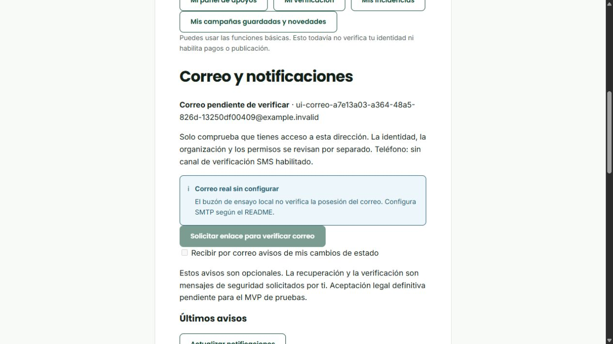

# Correo operativo · RicardoDev · 24/10/2026

## Resultado del incremento

Se conserva todo el trabajo integrado previo del Sprint 3 y se añaden verificación del correo propio, preferencias y avisos privados de cambios de estado con cola persistente/reintentos. Se reutilizan Nodemailer, `user_token`, `app_user.email_verified_at`, `status_history` y `notification`. No se añade una biblioteca, no se habilita dinero real y no se modifica el SQL oficial. Ver [ADR-014](decisiones/ADR-014-correo-operativo-mvp.md).

La migración 29 `ContactMail1792800000002` crea cuatro tablas en `brotar_extension` y permisos de columnas concretas. La instalación y la actualización utilizan el mismo registro de migraciones que el resto del proyecto; no requieren un seed manual. Una instalación existente conserva sus datos y no envía por correo su historial previo.

## Flujos para demostrar

1. Recuperación: configurar SMTP y reiniciar backend → cerrar sesión → Recuperar acceso → indicar correo propio → abrir el mensaje recibido → cambiar contraseña → iniciar sesión con la nueva. El enlace usado debe fallar y la sesión previa debe quedar revocada. No utilizar una cuenta ajena para esta prueba. La pantalla pública no revela si existe el correo ni promete entrega.
2. Verificación: iniciar sesión → **Mi cuenta → Correo y notificaciones → Solicitar enlace** → abrir el mensaje en el mismo navegador/origen → **Confirmar correo**. Si no hay sesión, iniciarla en otra pestaña y volver al enlace original; el enlace no se confirma por abrirlo. Vence a los 30 minutos; reenvío tras un minuto, hasta cinco solicitudes/hora. Un enlace de otra cuenta, vencido, revocado o usado se rechaza.
3. Preferencias: ya verificado el correo, activar **Recibir por correo avisos de mis cambios de estado**. Es una elección opcional; seguridad solicitada y avisos opcionales son independientes. El teléfono continúa sin verificación SMS.
4. Aviso: provocar un cambio válido con las cuentas/roles separados del módulo correspondiente, por ejemplo enviar una campaña ya completa a revisión o decidir un expediente DEMO. Esperar al procesamiento del backend y pulsar **Actualizar notificaciones**. Solo el titular consulta sus avisos; el contenido privado se abre en el módulo autenticado. El estado “Aceptado por el servidor de correo” no significa “leído”.
5. Fallos: sin SMTP la verificación muestra canal no disponible; los avisos no se presentan como enviados. Los tests automatizados sustituyen solo el transporte para simular fallo, reintento, agotamiento y baja de suscripción; no se envía a correos ficticios de los fixtures.

## Contrato HTTP añadido

Todas las rutas requieren sesión/REGISTERED_USER y no admiten elegir otro titular en el cuerpo. Las escrituras verifican origen y AUDITOR conserva lectura. Solicitud, confirmación y preferencia comparten cuota persistente de escritura; solicitar enlace añade la cuota específica por cuenta. Las lecturas llevan `Cache-Control: no-store`.

| Método/ruta | Entrada / resultado |
|---|---|
| GET `/api/contacts` | Dirección propia, fecha de posesión válida o null, preferencia, disponibilidad del canal. No informa credenciales. |
| POST `/api/contacts/email/request` | `smtp_accepted` o `already_verified`; nunca devuelve token/enlace. 429 ante cuota, 503 sin aceptación del canal. |
| POST `/api/contacts/email/confirm` | `{token}` de 64 caracteres hexadecimales; confirma una sola vez para su cuenta/dirección. |
| PUT `/api/contacts/email/preferences` | `{enabled:boolean}`; activar exige correo verificado. |
| GET `/api/contacts/notifications` | Últimos 50 avisos propios y resultado de entrega/intentos; sin payload privado. |
| POST `/api/contacts/notifications/:id/read` | UUID y titular comprobados; marcar leído es idempotente. |

## Evidencia

- Conexión TLS/autenticación y prueba inicial al propio remitente verificadas. Usuario confirmó su recepción.
- Ensayo adicional real en BD QA aislada: alta sintética con la dirección autorizada → recuperación HTTP/SMTP → token hasheado → reset de un uso → sesión previa revocada → contraseña anterior rechazada/nueva aceptada → enlace de verificación real → confirmación única → preferencia → aviso aceptado por Gmail. Se retiraron exclusivamente los fixtures. Se encontraron en INBOX mensajes reales de recuperación, verificación y aviso mediante el conector Gmail; no se publica su contenido ni enlaces.
- Prueba PostgreSQL/HTTP de correo: sesión, origen, DTO, titular, expiración, revocación, reenvío, fallo de transporte, sustitución de contacto, ausencia de escalamiento de rol, preferencias, avisos privados, concurrencia, commit tardío, reintentos hasta fallo y AUDITOR en lectura.
- La suite de migraciones instala la base oficial vacía y ejecuta las 29 migraciones, conserva catálogos y demuestra categorías disponibles; rechaza una base incompleta y repetir `up` no duplica datos.
- Regresión completa: **38/38 integraciones aprobadas, 0 fallos y 0 omitidas**, con reinicio de PostgreSQL. Checks: **218 frontend + 215 backend + 8 ADMIN local**, lint/tipos/build aprobados; total **479 casos distintos**. La sincronización del estado nativo READ al marcar un aviso fue añadida después y se revalida en la prueba específica de correo; las repeticiones no se suman. Una ejecución anterior tuvo un timeout de Docker y un texto de reversión no alineado con el test; se investigaron y la ejecución final completa pasó.

Comandos: `corepack pnpm run check` en backend, `bun run check` en raíz; pruebas con escritura solo en copia QA preparada: `$env:ALLOW_DB_TEST_WRITES='true'; $env:DB_TEST_RESTART='true'; corepack pnpm run test:integration`. Las variables de prueba no se habilitan en una instalación de uso normal. El verificador de contratos HTTP comprueba 175 rutas.

La siguiente captura corresponde a QA **sin copiar la contraseña SMTP al `.env` de QA**, por eso informa canal ausente y mantiene la verificación deshabilitada; no es una captura de un fallo del Gmail original ya configurado.

También se extrajo el árbol de entrega en una carpeta nueva sin node_modules ni archivos .env: bun install --frozen-lockfile/build y corepack pnpm install --frozen-lockfile/build aprobados; Express resuelve como dependencia explícita en la instalación limpia. No se copiaron dependencias instaladas a esa carpeta.

## Instancia original

Se arrancó exclusivamente el contenedor original V2, verificando proyecto y publicación `127.0.0.1:15433`. Se guardó un dump privado previo a los cambios fuera de Git. Se aplicaron las migraciones pendientes de 7 a 29, sin sustituir datos: ninguna pendiente, inventario oficial 59 tablas/5 vistas/8 secuencias/31 enums/16 funciones/40 triggers/134 FK conservado. La API inicializada sobre esta base confirmó readiness; el diagnóstico SMTP confirmó TLS/autenticación sin enviar mensajes adicionales. No se copiaron fixtures de QA a la base original.

## Publicación y pendientes

Destino autorizado: **RicardoDev**, con README y migraciones. DEV se conserva como entrega de Sprint 2. La contraseña de aplicación no se incluye en Git; existe una exportación privada de solo los campos de correo para traslado controlado, y un importador que conserva la configuración PostgreSQL propia del receptor.

S1-12: cierre técnico de recuperación real. S3-26: bloque de correo implementado; tarjeta integral en curso por legal/revalidación del alcance restante. S3-19 y S3-21: QA/aceptación global pendientes, igual que las funciones generales no entregadas por Santiago/Alison. S1-11/legal, SMS y una eventual entrega en DEV no se dan por completados con este push.
